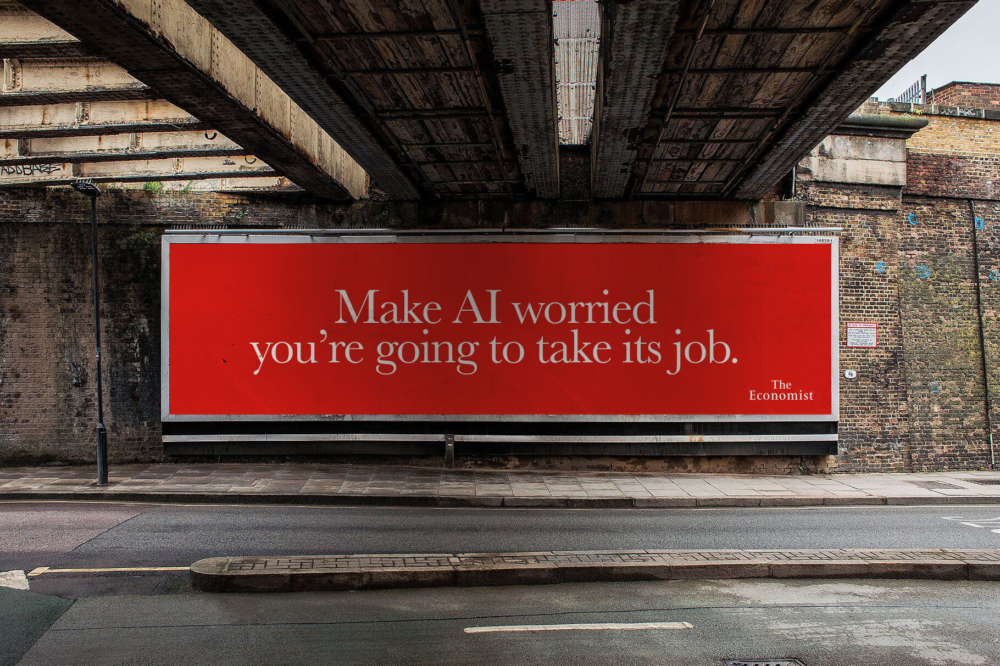
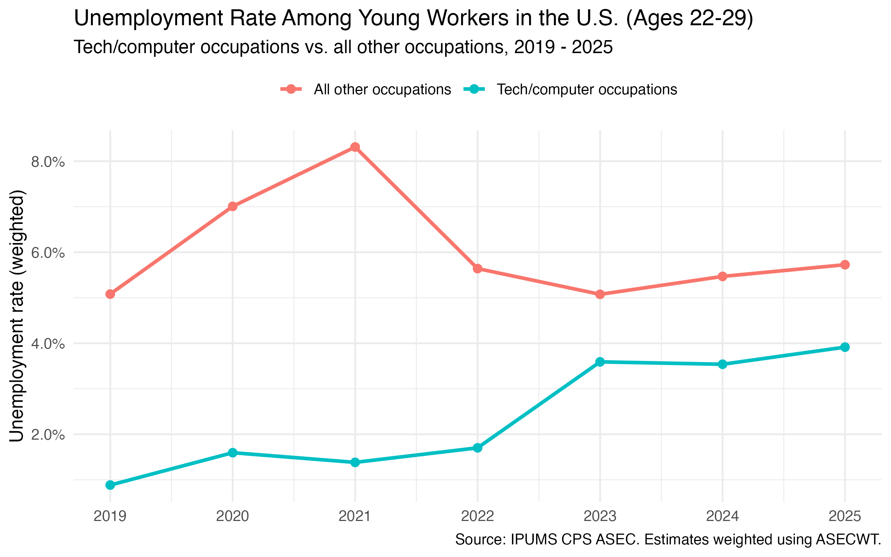
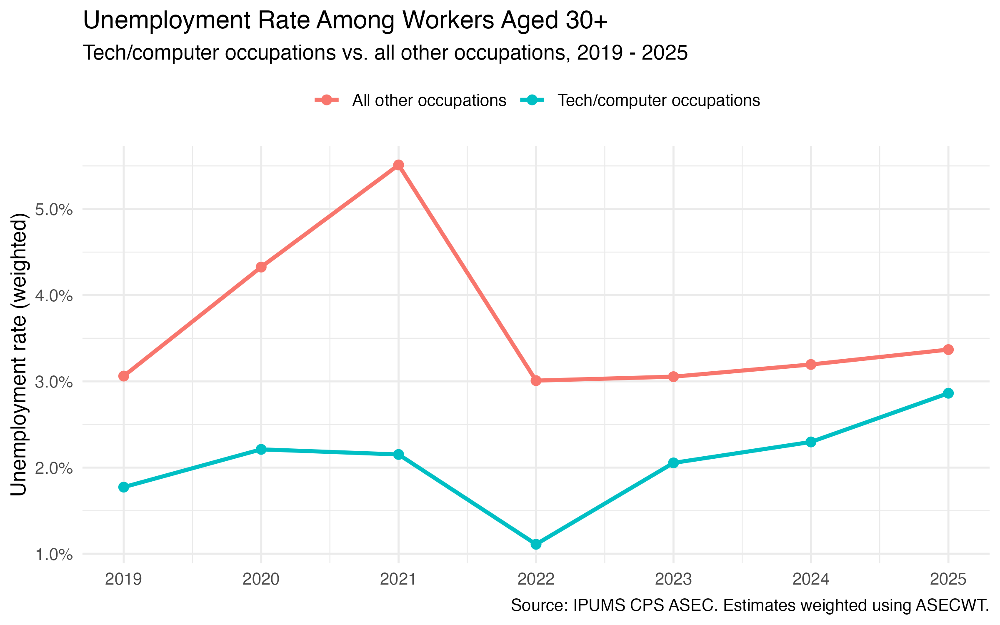
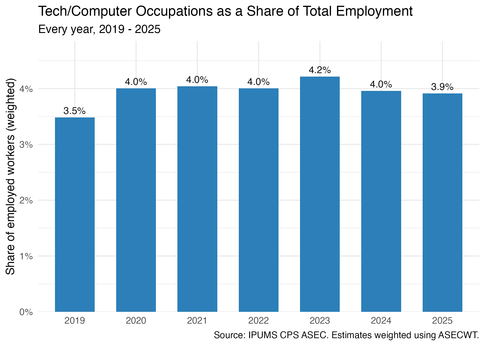
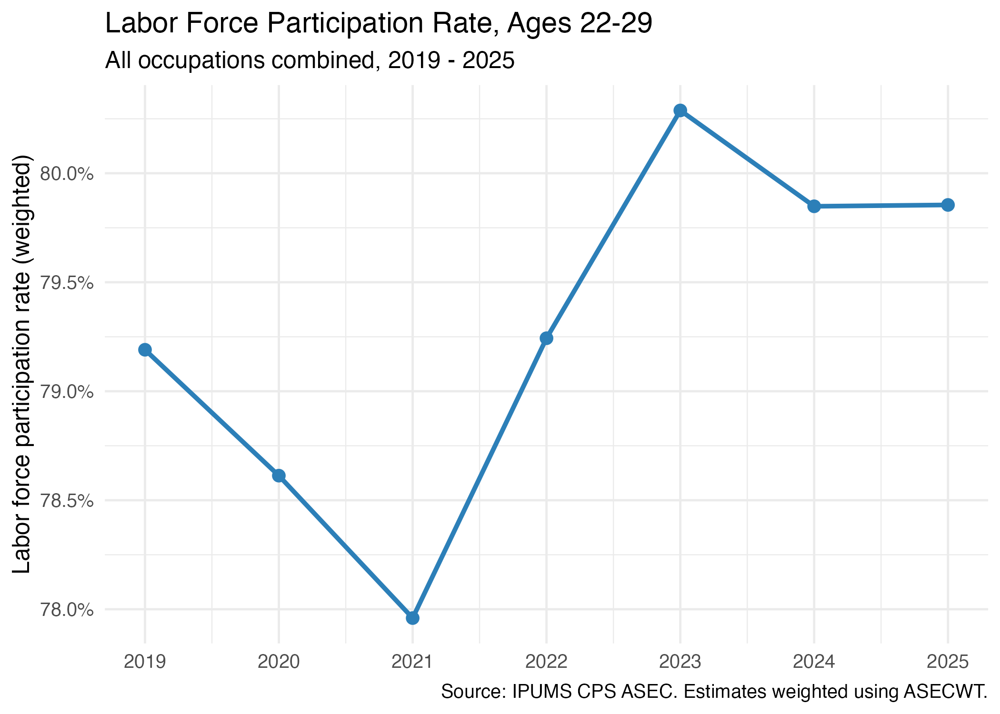

{width="900px"}

Worrying about AI replacing humans in the labor market may be one of the most common concerns among workers since the launch of ChatGPT in late November 2022. I wanted to see if there is any sign that generative AI has actually affected the labor market. Using IPUMS CPS data from 2019 to 2025 (four annual surveys before ChatGPT’s launch and three after), I focused my analysis on comparing employment outcomes for "computer occupations" (software developers, programmers, systems analysts, and similar roles) with overall employment outcomes (all occupations), using four visuals built from weighted CPS estimates.

The first insight is that among workers aged 22–29, tech unemployment stayed low from 2019 through 2022, between roughly 1% and 2%. Then it jumped to about 3.6% in 2023 and has stayed elevated since, reaching roughly 4% by 2025 (see Figure 1).

{#fig-1 width="700px" fig-align="center"}

That alone wouldn’t mean much, except that between 2022 and 2023, when tech unemployment roughly doubled, unemployment in other occupations edged down as the broader job market recovered from the pandemic. The pattern for workers 30 and older is a bit different: the 2022 reading is an unusually low trough, so tech unemployment in 2023 was about where it had been in 2020–2021, and the clear increase comes in 2024 and 2025 (see Figure 2). Either way, tech unemployment has risen while unemployment elsewhere has stayed comparatively flat, which suggests something specific is affecting tech occupations.

{#fig-1 width="700px" fig-align="center"}

This doesn’t look like AI making tech jobs disappear outright: computer occupations haven’t shrunk as a share of total employment, which has hovered between 3.5% and 4.2% the entire period (see Figure 3). But a stable share doesn’t rule AI out. If AI shows up as slower hiring rather than layoffs, we’d see exactly this: people who lose tech jobs take longer to find new ones, so unemployment rises while the occupation’s share barely moves, at least at first. What Figure 3 rules out is a collapse of tech employment, not a gradual squeeze on hiring.

{#fig-1 width="700px" fig-align="center"}

At this point it seems important ruling out the obvious alternative explanation. For this, I checked whether young people are just giving up on work in general. If overall youth labor force participation were falling, the tech-unemployment rise might just be one symptom of a broader retreat of young people from the job market, which would indicate that there is no specific factor affecting tech jobs at all. However, according to the data, participation among 22–29 year-olds actually rose to a peak in 2023 and has held steady since (see Figure 4). Young workers are still out there, still looking for jobs. They're just not landing tech jobs as easily as they used to.

{#fig-1 width="700px" fig-align="center"}

So does this mean AI is the cause? The timing is less informative than it first looks. The CPS survey I use is fielded in March, so the 2022 reading predates ChatGPT’s late-November launch, and the sharp increase happened somewhere between the March 2022 and March 2023 surveys. That window includes ChatGPT’s launch, but also the first year of the Federal Reserve’s aggressive rate hikes, a pullback in venture funding that led many tech firms to slow hiring or cut staff, and large layoffs at Meta, Amazon and Google as they unwound pandemic-era overhiring. With one reading per year, I can’t tell whether the increase came before or after November 2022, so the timing doesn’t favor AI over these other explanations.

Each of these forces could produce the pattern I see: rising tech unemployment with a stable employment share. Untangling them would take more granular data, such as task-level measures of how exposed specific jobs are to AI tools, rather than a broad occupation category.

**The takeaway**

The rise in tech unemployment is consistent with generative AI’s launch, but it is equally consistent with rate hikes and the correction of pandemic-era overhiring. A stable employment share doesn’t rule AI out, and annual data can’t separate AI from the other forces. The data show that something changed for tech workers around 2022–2023, not necessarily what caused it, or how much each factor contributed. A more in-depth analysis is required to have a more complete picture that explain the behavior of the tech labor market.

Full code, data, and README are available on GitHub: [AI and Jobs](https://github.com/emiliomb-png/AI-and-Jobs)
