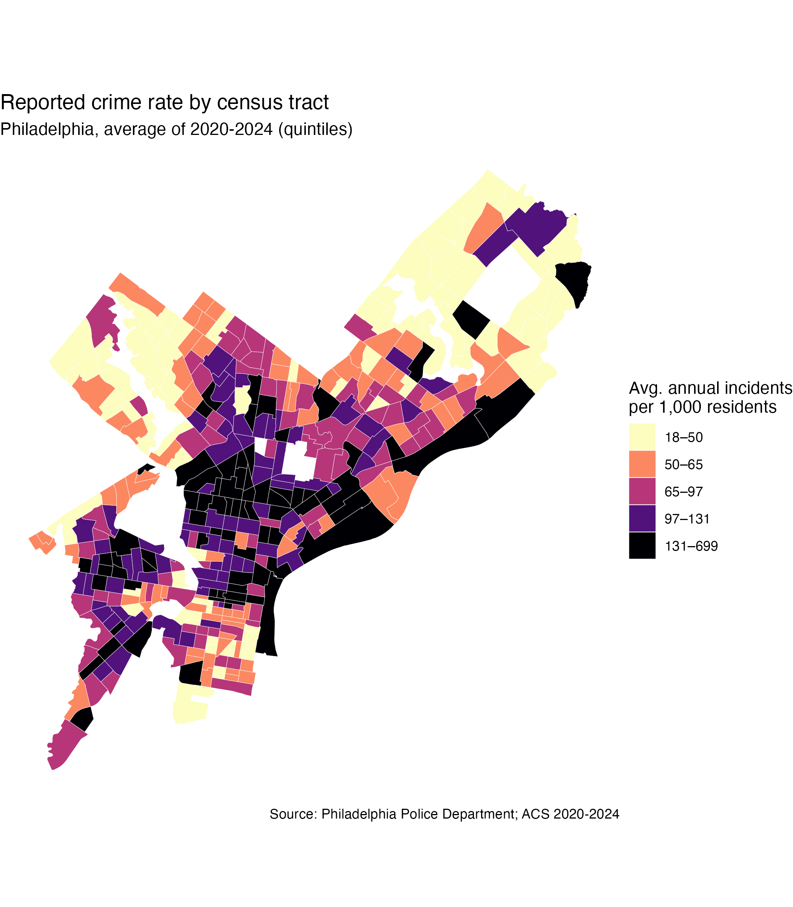
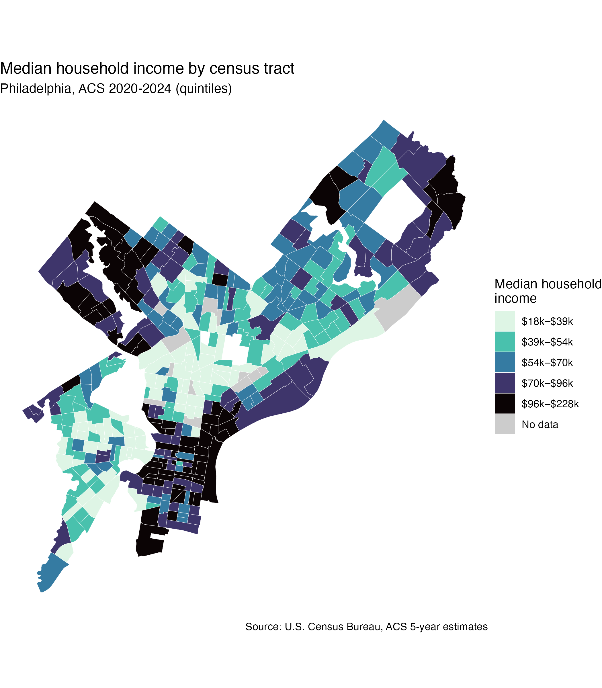
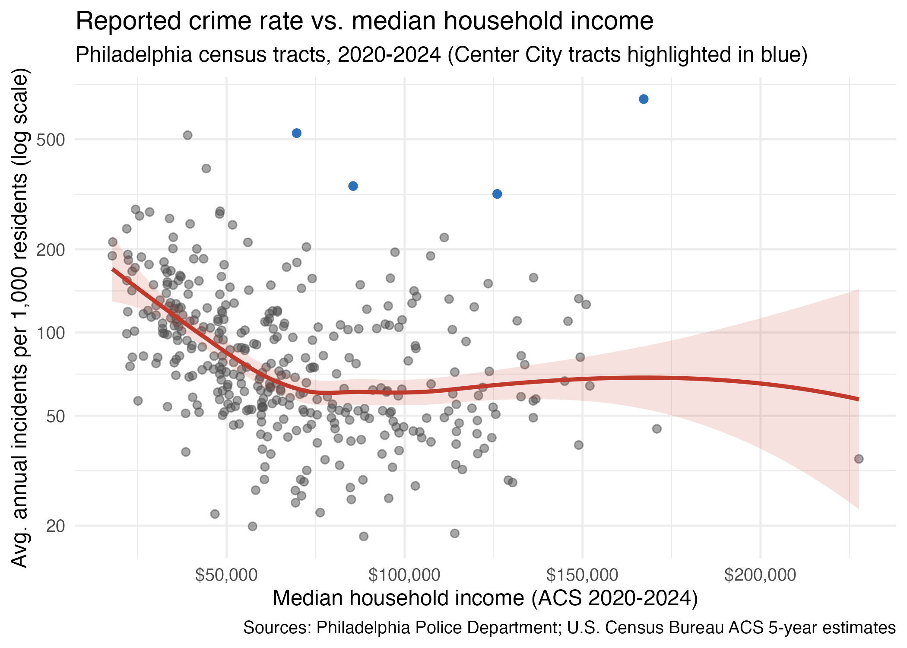

{width="900px"}

I wanted to see in which parts of Philadelphia crime was worse to identify the most potentially dangerous parts of the city. So I mapped the data and tried to understand whether the pattern follows how much money households earn. To do this, I used Philadelphia Police Department incident reports from 2020 to 2024, covering every offense type, about 730,000 incidents in all. I averaged them to a typical year, then divided by each census tract’s population to get incidents per 1,000 residents. Census tracts are neighborhood-sized areas of a few thousand people, and using a rate keeps big and small areas comparable. For income, I used the Census Bureau’s median household income estimates for the same five years. I left out tracts with fewer than 500 residents, which left 387 tracts. Thirteen of those had no reliable income estimate.

On the crime map (see Figure 1), the darkest tracts (highest rates) cluster in a broad band through the middle of the city, including much of North Philadelphia, with more dark patches in West and Southwest Philadelphia. The lowest rates are mostly in the far Northeast and Northwest. Now look at the income map (see Figure 2), where darker also means higher. The lightest tracts (the lowest incomes) sit in that same central band.

{#fig-scatterplot width="700px" fig-align="center"}

The highest incomes show up in the Northwest and Northeast, the areas that look calmest on the crime map. Overall both maps paint a suggestive picture: areas in Philadelphia with higher crime rates are associated with lower median household income.

{#fig-scatterplot width="700px" fig-align="center"}

Now, as an initial approximation to understanding the information from the previous two maps, I plotted the relationship between income and crime (see Figure 3). On this plot, each dot is a tract. Moving right means higher income, and moving up means more crime per resident. The red line shows the typical trend. The plot shows that, at the low end, tracts with incomes around \$20,000 average about 170 incidents per 1,000 residents a year. By roughly \$70,000, that falls to about 60, a drop of around two-thirds. Past \$70,000, the line goes flat. A tract at \$150,000 looks about the same as one at $80,000.

This suggests that there isn't a relationship that can be simplified to “more money, always less crime.” This rather looks more like a threshold: crime is much higher in the lowest-income neighborhoods, and income above the middle range doesn’t go with much further decline. The dots are also widely scattered. Among tracts near $40,000, rates run from under 50 to more than 500. Income explains part of the story, but not all of it.

{#fig-1 width="700px" fig-align="center"}

It is worth noting the four blue dots floating above the pack. These are Center City tracts, with rates of roughly 300 to 700 average annual incidents, despite middle-to-high incomes. The likely explanation for these outlier dots lies in the math. Rates divide by residents, but Center City’s incidents involve commuters, shoppers, tourists and nightlife crowds. Few people live there and many pass through, so the rate looks inflated. That is a result of how I measured the variable, not evidence that wealthy residents there face more crime. These tracts may also tug the red line upward at higher incomes, so the flat stretch could be slightly exaggerated.

Though the previous figures point to a correlation between income and crime, it is important to remember that this relationship is just that: correlation, not causation. In this analysis, income likely stands in for other things like housing conditions, job access and public investment. Neighborhood averages say nothing about any individual household. 

**The takeaway**

Reported crime in Philadelphia is concentrated in lower-income parts of the city, and the drop-off is steepest at the bottom of the income scale. But it is important to remember that income is only part of the picture, and that busy commercial districts break the pattern. A more in-depth analysis could also look at the relationship between income and violent crime and compare it with overall crime to determine if the type of crime changes the results of this analysis. Including additional variables (like unemployment rates and public investment by tract) may provide additional insights to the pattern presented here.

Full code, data, and README are available on GitHub: [Crime in Philadelphia](https://github.com/emiliomb-png/Crime-in-Philadelphia)
