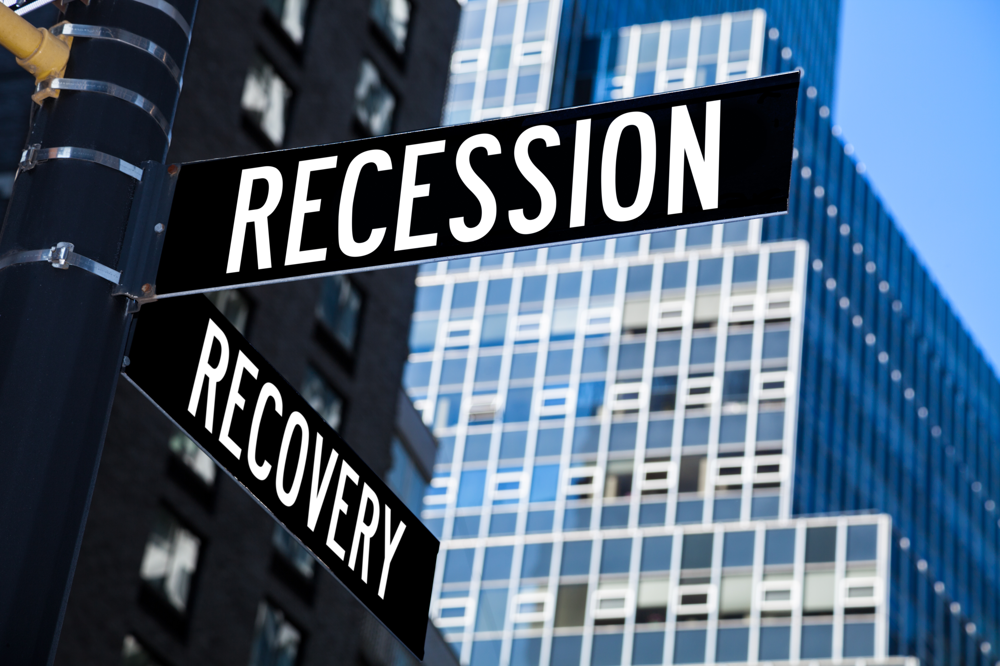
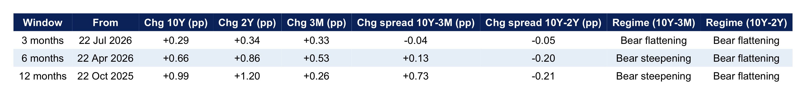

{width="900px"}

Is there a way to predict whether the economy is heading for a recession? Every few years, newspaper headlines ask this same question, usually based on the observed behavior of bond yields. I wanted to understand what, if anything, can bond yields signal about future recessions, and whether this signal is flashing now.

The first relevant finding is that it’s not about how high yields are. It’s about the shape of the curve. Bond yields change with the length of the loan. Normally, lending to the government for 10 years pays more than lending for 3 months, because you’re tying your money up for longer. That gap, the spread, is usually positive. Sometimes it flips. Short-term yields rise above long-term ones, and the curve is “inverted.” Investors are saying they expect rates to fall later, usually because the economy is weakening. That’s the recession signal.

To understand what history says about this, I pulled U.S. Treasuries spread data since 1982 and shaded the recessions in grey (see Figure 1). The pattern is hard to miss. The spread dipped below zero before the early 1990s recession, again before 2001, and again before the 2007–09 downturn. It also dipped briefly before 2020, although that recession came from a pandemic that no yield curve could have predicted.

{#fig-scatterplot width="700px" height="1000px" fig-align="center"}

The signal isn’t a stopwatch. Recessions tended to show up months, sometimes a year or more, after the inversion began, and often after the curve had already recovered. It also isn’t perfect. The most recent inversion was one of the deepest in the data. The 10-year minus 3-month spread fell to nearly -1.9 percentage points, and it stayed negative until October 2025. No clear recession followed. With only a handful of recessions in the sample, one miss matters a lot.

Considering this, it is worth asking what is happening now. Yields have been climbing, which is a common headline these days. However, the important factor to consider is that a rise in yields only matters if short rates rise faster than long ones. That flattens the curve and moves it toward inversion. If long rates rise faster, the curve steepens, which usually points to inflation worries or a demand for more compensation for lending long, not to a coming recession. To assess this, I delved further into the data and I split the recent moves into short and long ends (see Figures 2 and 3):

**Last 3 months:** Everything rose by about 0.3 points, and the curve barely changed. The 10-year minus 3-month spread moved by just -0.04.

**Last 6 months:** The 2-year yield jumped the most (+0.86), ahead of the 10-year (+0.66). Against the 2-year, the curve flattened. Against the 3-month, it steepened a little.

**Last 12 months:** The 10-year is up about a full point and the 2-year is up 1.2. The 3-month yield barely moved (+0.26). So the curve flattened against the 2-year but steepened a lot (+0.73) against the 3-month.

{#fig-scatterplot width="700px" height="700px" fig-align="center"}

{#fig-scatterplot width="700px" fig-align="center"}

The two measures disagree because of what happened a year ago. Back then, the 10-year minus 3-month spread was still inverted. Today it’s positive, at about +0.74. The 10-year minus 2-year spread is positive but thin, at about +0.31.

**The takeaway**

As the previous analysis shows, the curve isn’t inverted. Both main spreads are positive, so the "classic" signal isn’t on. The warning has historically come from the curve turning negative, not from it being low. The direction is mixed. The part of the curve that most resembles the recession pattern, the 2-year catching up to the 10-year, is flattening. The 3-month comparison points the other way. This suggests that something else is going on. 

The Fed’s policy rate is about 3.9%, while the 3-month yield is above 4.2% and the 2-year is near 4.7%. Markets seem to be pricing in rates staying higher or going higher, not cuts. That’s closer to an inflation story than a recession story, though I’d hold that read loosely.

It is worth noting that this is a small sample, and the most recent inversion didn’t produce the expected recession. Policy, bond purchases and global demand for U.S. debt can all distort the curve. And the shape of the curve only tells you what investors expect, not what will happen, therefore any conclusion should be a cautious one. Rising yields on their own aren’t a recession alarm. The thing to watch is whether the 2-year keeps closing in on the 10-year and pushes the spread back below zero. If that happens, it might be worth revisiting recession questions.

Full code, data, and README are available on GitHub: [Interactive Visualization](https://github.com/emiliomb-png/Interactive-visualization)
