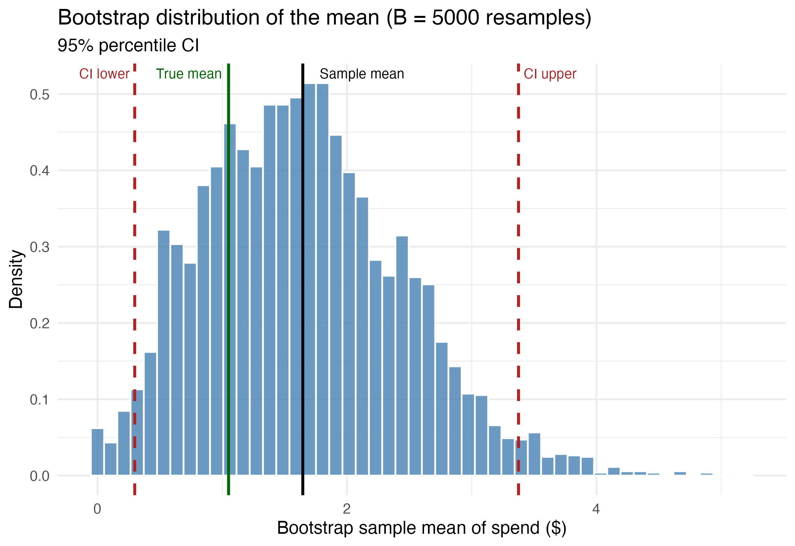
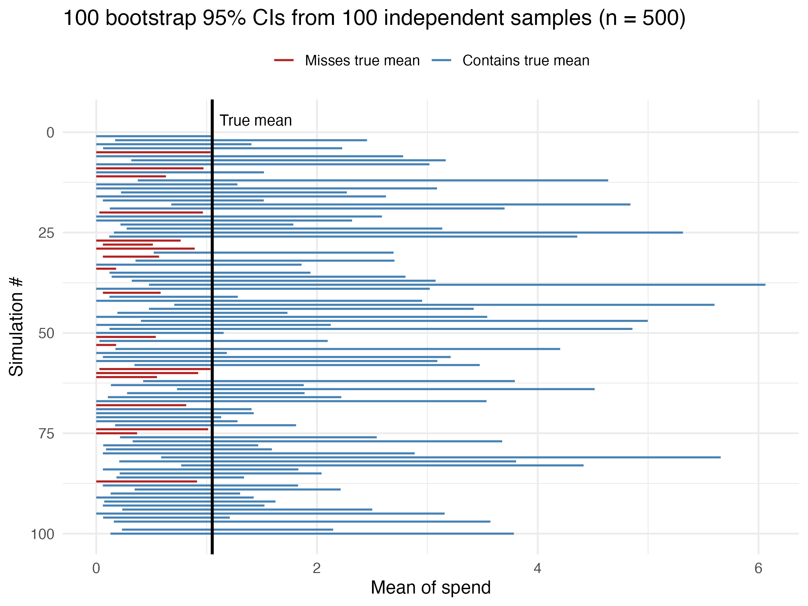
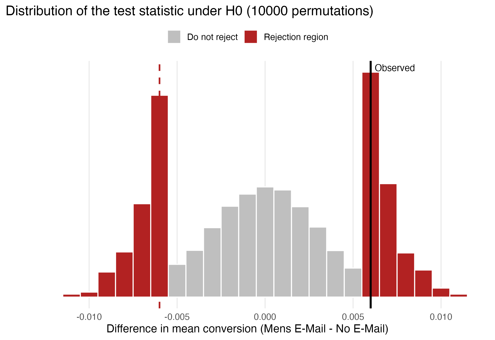

{width="900px"}

Every marketing email has a price: the cost of writing and sending it, and a quieter one, because customers who get too many messages stop reading them. So before repeating a campaign, a company should ask: did this one actually get people to buy? I used the Hillstrom dataset, an experiment in which 64,000 customers were randomly sent a men’s promotional email, a women’s one, or nothing at all. Random assignment makes the groups alike except for the email, but it doesn’t settle the question: even if I had emailed no one, two random groups would buy at slightly different rates by luck. So if the emailed group buys more, was it the email or luck?

Statistical inference is the toolkit for that problem, and I used simulation to work through it. I treated all 64,000 customers as the entire world, so I knew the truth, then took small samples to check whether my methods found it. Suppose I average what 500 customers spend. That number depends on which 500 I picked, so how far off could it be? The bootstrap, a tool that redraws customers from our own sample over and over, gets around this by treating the sample as a miniature version of everyone. I redrew 500 customers 5,000 times, putting each customer back after every draw (so repeats were possible), and recorded the average each time (see Figure 1).

{#fig-scatterplot width="700px" height="700px" fig-align="center"}

The 5,000 averages mostly landed between \$0.50 and \$3, showing how much a number based on 500 customers can wander. Discarding the lowest and highest 2.5% leaves a range of about \$0.30 to \$3.40, marked by the red dashed lines. This is the 95% confidence interval. My sample’s average was about \$1.65, while the true average across all customers was about $1.05. My sample overshot by a lot, yet the interval still included the truth. An interval admits the sample may be off and shows by how much.

What does “95%” mean? Not that this particular interval has a 95% chance of containing the truth; it either does or it doesn’t. The 95% describes the method: repeat the study many times, and about 95% of the intervals should capture the truth. So I tried it, drawing 100 independent samples of 500 customers and plotting each interval (see Figure 2).

{#fig-scatterplot width="700px" height="700px" fig-align="center"}

Blue lines cross the true average (the black line), so they got it right; red lines stop short, so they missed. In real life you would see just one line and never know its color. There was also a surprise: about 20 of the 100 are red, far more than the 5 expected. Most customers spend nothing and a few spend a lot, so a sample can hold very few buyers and the average swings widely. The 95% promise holds only under certain conditions, and they weren’t met here, so I judged the campaign on a simpler question: did a customer buy at all?

Now for the question I started with. I compared 2,000 customers who got the men’s email with 2,000 who got nothing. The emailed group bought more, by a bit over half a percentage point. Real effect or luck? I put luck on trial. Suppose the email did nothing, then the labels “email” and “no email” mean nothing, so I can shuffle them among the 4,000 customers and measure the gap again. After 10,000 shuffles, I could see the gaps luck alone produces (see Figure 3).

{#fig-scatterplot width="700px" height="700px" fig-align="center"}

Most shuffles landed near zero, the grey bars, because random labels usually leave the groups nearly equal. The red bars mark the most extreme 5%, where a gap is too unusual to blame on luck. The black line is the gap I actually saw and it sits in the red, near the edge of the zone. The p-value says the same thing as a number: the share of shuffles with a gap at least as large as mine.

**The takeaway**

So, did the campaign work? Yes. About 1.25% of customers who received the men’s email made a purchase, against 0.57% of those who didn’t, more than double the rate. Because assignment was random, the email is the likeliest explanation. But the result depends on the test’s setup, and I ran it with one set of choices. With fewer customers per group, the grey bars would spread wider and the test might miss a real effect. With more, even a small gap would stand out. A stricter cutoff, 1% instead of 5%, would shrink the red zone, so a borderline result like mine might not count. Rare outcomes like purchases are also noisier than common ones like site visits.

One last point: statistically real isn’t the same as profitable. Whether the extra purchases cover the campaign’s cost is a separate question.

XXX Full code, data, and README are available on GitHub: [Interactive Visualization](https://github.com/emiliomb-png/Interactive-visualization)
