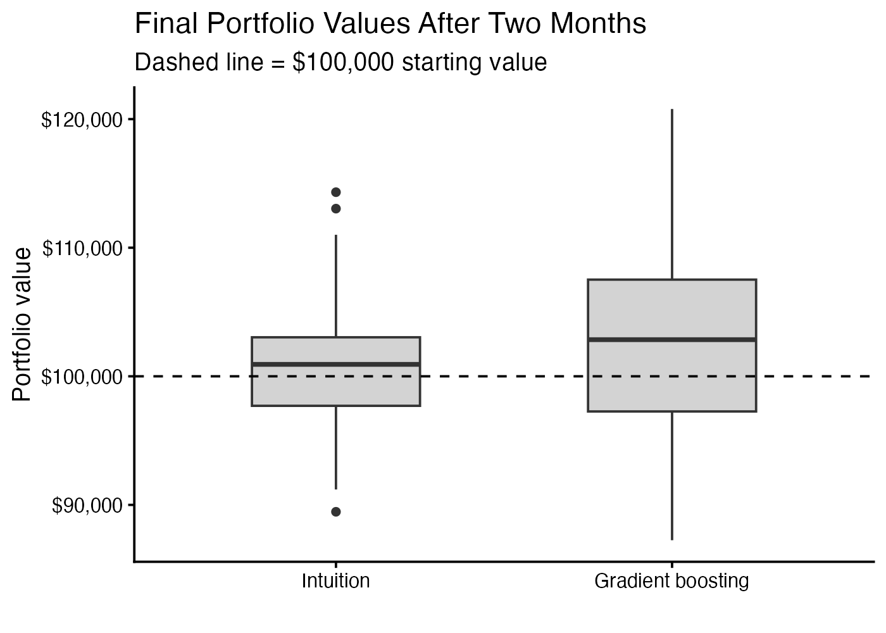
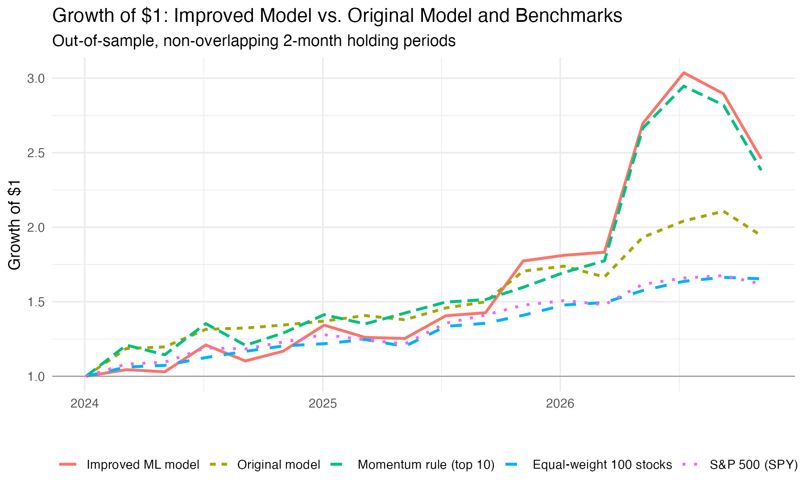

{width="900px"}

Does intuition beat a computer prediction of stock market performance? To answer this question I participated in a classroom experiment in which each of 45 teams built two portfolios, each starting with $100,000 and held for two months. The first portfolio was built from pure intuition, that is, stocks the team expected to perform well and picked without formal analysis. The second portfolio was built using gradient boosting, a machine-learning method that works like a panel of many simple “experts,” each correcting the mistakes of the one before. The model studied past patterns, such as which stocks had been rising, which were volatile, and which had just dropped. It ranked a list of 95 large U.S. companies, and teams built their portfolios from the highest-ranked stocks.

The intuition portfolios averaged about \$101,200 (+1.2%) (see Figure 1). The model portfolios averaged about \$103,100 (+3.1%) and beat the same team’s intuition portfolio in 30 of 45 cases. That sounds like a win, but the \$1,900 gap is within what chance can produce: if the model had no real edge, a gap this large would appear about 1 time in 10. The model’s results were also more spread out, from about \$87,000 to $121,000, so some of its edge came with extra risk.

{#fig-scatterplot width="600px" fig-align="center"}

So why is it so hard to predict stock returns? Well, prices already reflect what thousands of professionals know, so easy patterns vanish once people notice them. Over two months, random news and mood swings drown out real signals. And a model can only learn from the past, which may not resemble the future.

With this in mind, I asked whether it was possible to build a model that was more accurate than the one made for the classroom experiment. For this test, I made four changes to the gradient boosting model used in the classroom experiment. First, I asked a different question. Instead of raw returns, which mostly reflect whether the whole market rises, the new model predicted performance relative to the market over the same two-month horizon I actually held stocks. Second, I included better clues. Instead of raw prices, the new model saw comparisons that mean the same thing in any year, such as how a stock’s trend ranks against its peers that day. Third, I included more history: about eight years instead of two. Finally, I included one restraint: simpler models, tested on rolling time windows, so one lucky stretch couldn’t fool me.

To test the accuracy of the new model, I locked in the improved model, with no further tweaks, and tested it only on stock prices from 2024 to today, which it never saw during training. Then, I compared the improved model with four reference points: the original classroom experiment model, a simple momentum rule (buy the 10 stocks that have risen the most over the past year), an equal-weighted basket of the 95 large U.S. companies, and the S&P 500. The three stock-picking strategies each chose 10 stocks on the same dates and held them for the same two-month periods, so the comparison is fair.

Overall, the prediction was weak. A useful model should rank stocks so its favorites beat its least favorites. The improved model scored 0.015, where 0 means no skill. The original scored higher (0.062), so the added sophistication didn’t help. With only about 17 independent two-month periods, none of these scores is clearly distinguishable from luck.

Investment, for its part, looked impressive but wasn’t reliable. The improved portfolio averaged 6.3% per two months versus about 3% for the S&P 500, and \$1 grew to \$2.46 versus $1.62 (see Figure 2). But the momentum rule matched it almost exactly (6.1%), and one stretch starting in March 2026 delivered a 47% gain. Without it, the average falls to 3.8%, only slightly above the benchmarks. In a typical period, the model’s median return (2.1%) trailed both benchmarks. Its worst period lost 15%, versus 3% for the market. And its edge over every comparison could plausibly be zero.

{#fig-scatterplot width="700px" fig-align="center"}

**The takeaway**

The previous results suggest that a more sophisticated model still did not reliably predict returns. Its gains looked like one hot market stretch, not forecasting skill. Even though the headline numbers survived 10 basis points of trading costs, no investor could have counted on them: the ride included a 15% loss in a single period, and a simple momentum rule delivered nearly the same results.

It is also worth noting that this test has limits. It covers only 17 periods in one stretch of market conditions, and it uses a fixed list of large U.S. companies, so the results may not carry over to smaller firms or other markets. Still, the lesson holds: markets are hard to beat, and impressive-looking backtests deserve skepticism, especially when they rest on few observations.

XXXX Full code, data, and README are available on GitHub: [Email campaign](https://github.com/emiliomb-png/Email-campaign)
